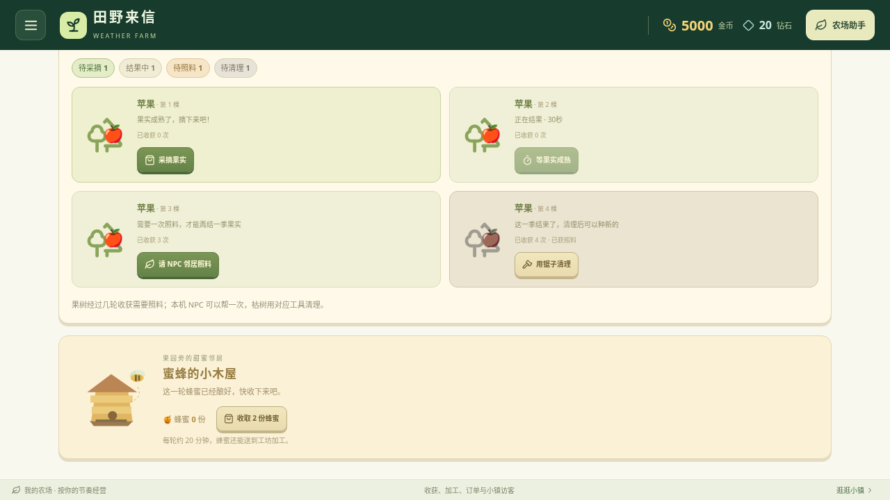

# 果园状态、收取空间与探索操作

v0.19.0 果园按真实游戏计时和树木状态显示“待采摘、结果中、待照料、待清理”的数量。成熟但空间不足的果树仍是待采摘，显示需腾出的准确空位并禁用采摘；鱼肉与蜂蜜同样检查对应仓库的两份容量。提示关联到按钮供读屏查看，不自动收取或预留容量。

果园种植、采摘、照料、清理、蜂箱建造与收蜜、钓鱼、采矿和成就领取均使用最新已接受的游戏状态；计时动作以实际提交时刻检查。上层属性延迟且页签重绘时保留之前操作，旧对象、冷却中的任务及已领奖项目由原规则拒绝。保存失败保留内存结果并明确提示备份。

此图明确使用隔离测试存档：预设等级、金币以及成熟/等待/照料/枯树，用于同时展示状态边界；不是新农场初始进度，也不代表自然游玩所得。画面来自实际 App，未用图片生成或修改库存文字。

## 验证

生产构建和331项规则测试通过。最终生产构建36组实际 App 检查通过：探索12组，订单回归12组，仓库回归12组，无页面异常。覆盖三种横屏尺寸、四状态计数与时间迁移、连续两树收成、满仓空间、NPC照料与清理、钓鱼和收蜜期限、采矿工具及容量、不同成就及重复领奖、保存失败、蜂箱重复建造。

另1组Vite直接挂载真实 ExplorationPanel/HoneyHive 源组件，刻意延迟上层 game 属性并跨页签重绘；两次采摘、收蜜、钓鱼、采矿和两项领奖共7次有效交易全部保留，重复操作被拒绝。它是源组件专项，与最终生产构建检查分开记录。

生产构建 index.html SHA-256：`c338cab1833b747dd3cce68143ee9b2da2080e7e1be2f285af2c86355044ba2f`。源组件 EconomyPanels.tsx SHA-256：`c2b99ca93609e90aa569626e1c012f06949c91a420346a32ec1d1d21ced63ee1`。

没有改变产量、报酬、冷却周期或存档格式。真实农场服务仍在独立界面；未进行安卓真机触控、系统下载或覆盖安装验证。
