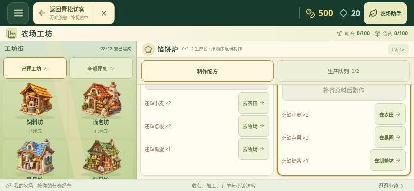

# 明确的物品来源

来源按钮直接说明目的地：农田、牧场、具体生产工坊、果园、鱼塘、矿山、蜂箱或仓库。工坊原料、小镇访客、门口邻居和实际页面跳转共用同一份来源解析，避免文字与实际去向分开维护。

98 种现有物品全部覆盖：12 种作物前往农田，5 种真实畜栏产物前往对应动物，57 种加工产物前往生产机器，11 种原始物产前往对应探索设施，13 种工具与扩建材料前往库存查看。

蜂蜜虽然使用动物类物品分类，来源仍是蜂箱；蜂蜡前往蜂产品工坊。苹果和苹果酱、矿石和金属锭、鱼肉和鱼汤也分别导航到采集设施与加工设施。按钮只查看来源，解锁、建造、扣料、生产、收取、接待与出售仍需原有手动操作。

小镇访客仍只使用原有允许的需求范围，没有为了展示原料来源而增加水果、鱼肉或矿石需求。这些原料的界面验证通过工坊配方完成。补货路径继续逐层返回配方，再返回原访客；进入其他页面或结束导航会清理临时路径。

## 验证

规则测试新增 9 项，检查全部物品的完整分区、所有生产机器、真实动物、六种果园水果、原料与加工品区分、工具材料回退、只读性和未知编号拒绝。

33 组最终生产网页检查通过，页面错误为 0。覆盖 640×360、844×390、1280×720，包含正常小镇需求、原料配方来源、门口邻居蜂蜜入口、库存回退、未解锁钓鱼限制和精确的配方／访客返回；完整游戏存档及四个真实资料键保持不变。

截图为最终生产网页的 844×390 横屏，使用通过存档校验的隔离 32 级测试农场，不代表新农场自然经营进度，也不是安卓真机画面。

浏览器复跑方式与现有脚本一致：先构建、运行 `npm run preview`，再运行 `python scripts/check-item-sources.py`。需要 Python Playwright 和 Chromium。脚本使用隔离测试存档和时钟，阻断外部 HTTPS，比较完整规范化存档及四个真实资料键。
