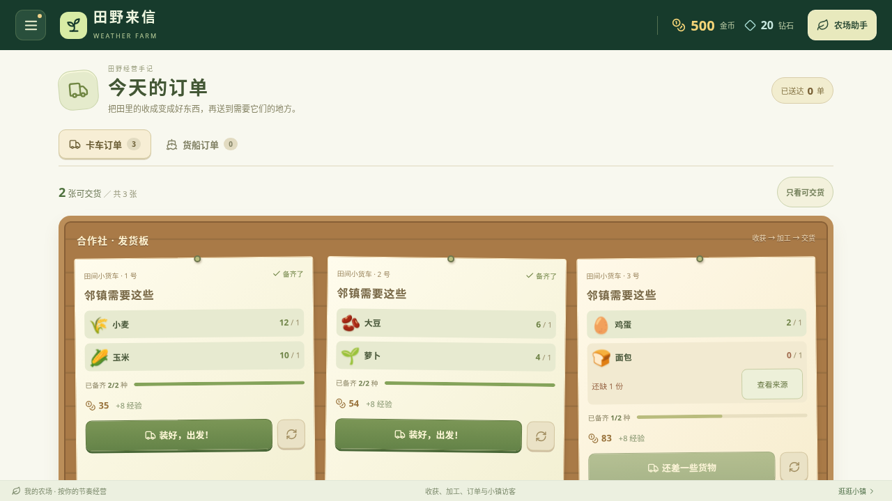

# 订单备货与连续交货

v0.17.0 新增“只看可交货”、实际可交货数量和逐单备货进度。筛选保留原订单序号，不修改订单或预留库存；空筛选可返回全部订单，不会误生成新订单。切换卡车／货船或收到新的订单页定位请求后恢复全部视图。

进度按备齐的商品种类计算，库存达到该商品所需数量才算备齐一种，超过需求不多算。读屏可获取当前备齐种类与总需求；减少动态效果时关闭进度过渡。所有订单共用库存，交货后其余订单立即重新核对。

交货、更换、接单均在执行时读取本页最新已接受的游戏状态，使用实际操作时刻。上层延迟返回新 game 属性时，本地筛选重绘也不重置已接受状态。重复旧订单编号由原有游戏规则拒绝。保存失败保留已接受的内存结果并明确提示导出备份，不把内存状态宣称已保存。

截图从空浏览器存储的新农场通过菜单进入订单页，在原生页面转场完成后截取，未注入存档、库存、等级或奖励，没有模拟时钟。

## 验证

331 项规则测试和生产构建通过。最终构建在 Chromium 执行 12 组实际 App 检查通过：三种横屏尺寸、真实进度与可交数量、键盘筛选与焦点、44 像素按钮、资料不变、共享最后一份库存、快速交两单与重复单、重复更换、保存失败、货船解锁限制、缺货来源定位、减少动态效果、真正空订单板接单。

另 1 组通过 Vite 直接挂载实际 OrdersPanel 源组件，刻意不向组件返回新 game 属性，并在两次交货间切换筛选触发本地重绘；两份交货都被保留、共扣两份小麦，重复旧单被拒绝。它是源组件专项，与生产构建 App 检查分开记录。

生产构建 index.html SHA-256：`c62ffed3d407f822838f65478d0e81a22c2eec4dfba88862bf2e24207db216e3`。源组件专项对应 EconomyPanels.tsx SHA-256：`4770e2253c2ce02a36e3b0bd23a496c1f55f3b289872259d97e61b61328d5847`。

没有改动生产配方、订单报酬、库存规则、存档格式或真实农场资料。未做安卓真机交互与系统覆盖安装验证。
