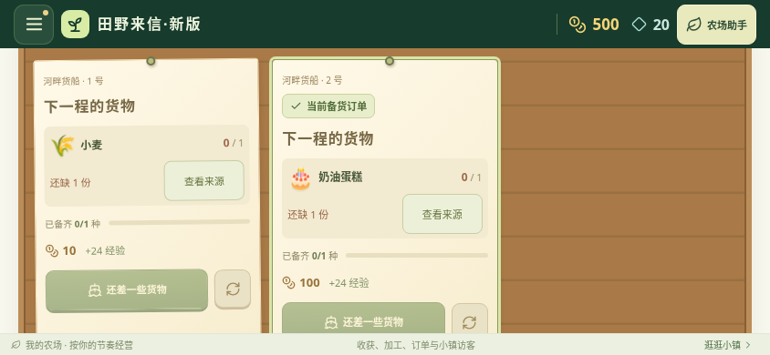

# v0.30.0 订单补货返回

从卡车或货船订单点击缺货商品的“查看来源”，来源页面保留“返回卡车／货船N号订单”。经过“蛋糕→奶油→牛奶”等多层加工链时，先逐层返回配方，最后返回原订单；自动恢复配送类型、取消可交货筛选，并滚动定位原卡片。

原卡片标记“当前备货订单”。时钟和库存变化不会反复滚动或抢焦点；普通导航、结束补货或恢复游戏备份后清除补货路径。定位绑定真实订单ID与配送类型；原订单已完成或更换时回到相应订单板，不选择同序号的新单。导航本身不消费库存，不发奖励。



截图使用明确构造的测试农场，不是真机照片或玩家资料。

355项规则测试及生产构建通过，包含4项订单身份与失效返回检查。新增24组浏览器检查通过，页面错误0；覆盖640×360、844×390、1280×720、键盘和点击、默认动画及减少动态效果、卡车原料、船订单多层配方、取消和普通导航、时钟焦点稳定、真实收获后交付及换单后不重复奖励。

v0.30.0沿用v0.29.0的独立包名和固定签名，APK资源名仍为field-letter-next.apk；支持直接覆盖独立新版。旧包名应用仍可保留，首次迁移见[安装与迁移](parallel-installation.md)。未实测安卓真机帧率、功耗或系统安装器中的覆盖安装。

原有小镇补货22组、页面按需加载27组、物品来源33组回归检查均通过；本轮合计106组浏览器检查，页面错误0。

## 发布与游戏内更新验证

2026-11-04已发布v0.30.0，versionCode31。[Android构建41817530362](https://github.com/schlapiadeziel-rgb/weather-farm-mobile/actions/runs/41817530362)与[发布流程41818585166](https://github.com/schlapiadeziel-rgb/weather-farm-mobile/actions/runs/41818585166)均成功，源码标签为`8a4ad758c0f53dab11f48510c2269f7c55b52fa4`。

实际v0.29.0更新器已对公开v0.30.0元数据与下载APK通过识别、大小及SHA-256校验；v0.28旧包名更新器忽略本发布，v0.30.0不重复提示自身。新版APK证书与已发布v0.29.0一致，包名、源码版本、签名前后载荷及16KB对齐检查通过；公开源码ZIP与标签的git archive逐字节一致。

游戏内操作：左上角农场菜单 → 检查更新 → 下载 → 安装更新 → 在安卓系统页面确认。Android8及以上首次可能需要允许“田野来信·新版”安装应用，再返回游戏继续安装。v0.29及之后的独立新版覆盖更新保留当前资料；仅从旧包名应用首次迁入时需要分别导出和导入备份。系统安装界面未做真机实测。

```text
7f0edebab1ad6796c10bbb13b4e93fa3bfed4de686395a43da553e3315bc84dd  field-letter-next.apk
b4377fa11ae8a68f1791c5cf7ff3bd0ac0bcd27e648d0f49fe7d31369e37cfef  weather-farm-next-source.zip
```
