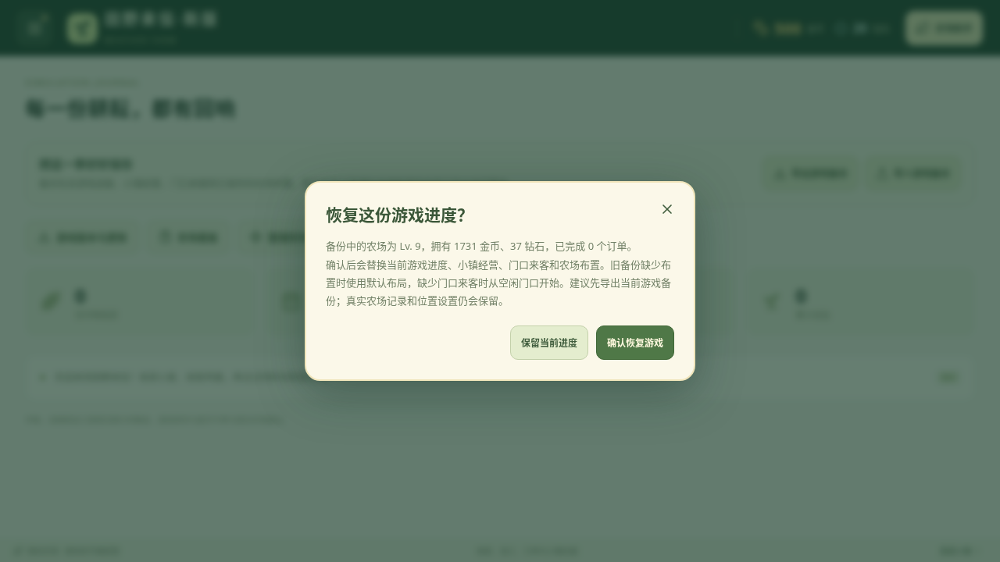

# 田野来信·新版：独立安装与迁移

v0.29.0 独立安装版使用包名 `com.fieldletter.farm.next`，手机图标名称为“田野来信·新版”。原应用 `com.fieldletter.farm` 继续保留；新版是另一个应用，不覆盖原应用或自动读取其私有文件。

安装包为 `field-letter-next.apk`，适用于 ARM64 Android6.0+。iPad/iPhone不能安装APK。先保留旧版，确认备份和新版数据正确后，再自行决定是否继续保留旧版。

## 迁移已有资料

1. **游戏进度**：旧版“农场菜单 → 农场日记 → 导出游戏备份”。在新版同一位置选择“导入游戏备份”，核对预览后点“确认恢复游戏”。恢复会替换新版当前游戏进度；不会自动导入真实农场资料。
2. **真实农场记录**：旧版“农场助手 → 农场工作台”，在记录区域点“导出备份”。新版进入相同区域点“合并备份”。资料包含农场资料、待办和实测；已有同编号记录保留，新资料合并。
3. **已保存案例**：旧版“农场助手 → AI现场观察／AI诊所 → 本机案例 → 备份与恢复 → 导出全部案例”。新版在相同位置“导入案例备份”，核对后“确认合并”。已有同编号案例不会被覆盖。
4. **未保存文字草稿**：在旧版诊所单独使用“导出文字草稿”；新版通过草稿恢复入口导入。它不包含在已保存案例备份中。

位置和部分设置需重新选择。本地AI模型不会从旧应用私有目录自动迁入：可重新选择自己保留的模型文件导入，或重新下载。案例只迁移既有文字和媒体说明，原照片／视频需要保留并重新选择。

v0.27和v0.28相关导出／存档源码一致。本轮使用实际v0.28导出函数生成隔离备份，经新版生产网页完成21组导入检查：三个横屏尺寸下的预览、取消、确认恢复、真实资料保护、记录合并、案例去重和再次导出均通过，页面错误为0。浏览器检查不代表已完成安卓真机共存安装或模型迁移实测。

截图使用明确构造的旧版测试存档，不是实际玩家资料或安卓真机照片。

## 独立更新与签名

新版只识别 `field-letter-next.apk` 和 `SHA256SUMS-next.txt`，旧版继续识别原文件名。发布页不混放两个通道的APK与校验清单，避免旧版误提示安装不同包名的应用。新版仍检查同包名、更高版本、SHA-256和相同新签名后才启动系统安装器。

新证书摘要位于 `android-next-signing-certificate.sha256`；旧证书摘要保持原样。本机私钥与恢复码不进入源码或公开附件，仓库只保存随机恢复码保护的GPG AES-256密文备份。维护者需要另行保存私下交付的完整签名备份；配置 `ANDROID_NEXT_SIGNING_RECOVERY` 后，未来CI可解密该备份并使用同一新签名。

使用 `scripts/sign-next-apk.py` 与 `scripts/verify-next-apk.py` 核对新包名、源码版本、固定新证书、签名前后应用载荷及16KB对齐。原包名在签名前即被拒绝。发布工作流另核对成功构建、源码提交和版本标签完全一致。
