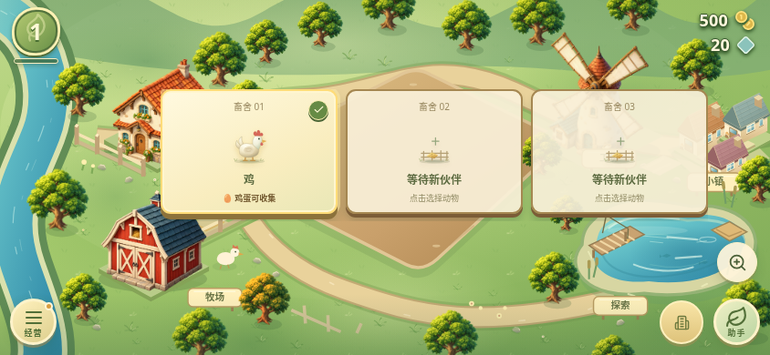
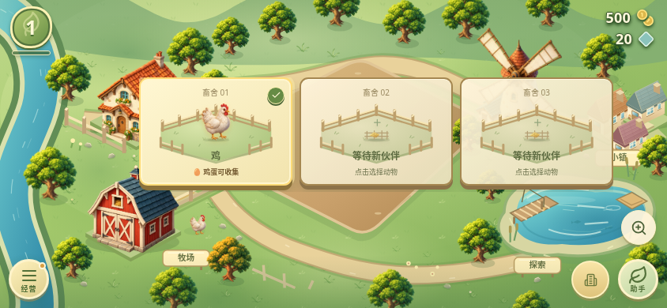
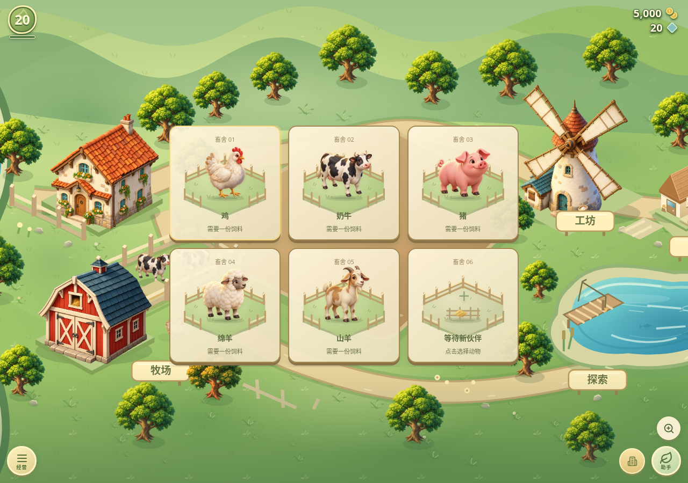

# v0.24.0 牧场画面升级

鸡、奶牛、猪、绵羊和山羊使用新生成的原创动物插画，统一左上方暖光与柔和材质。畜舍增加草地、木栏和接地层次；主地图的装饰奶牛和鸡也复用相同美术。

插画与原矢量使用相同的外层布局框，畜舍背景不拦截点击。等级、投喂、计时和收取状态继续由游戏规则控制；装饰奶牛和鸡不表示已购买的动物数量。动物为静态插画配轻微整体呼吸，没有独立逐帧眨眼或尾部动画。减少动态效果时关闭动画；图片加载失败时独立回退原矢量。

五张透明 WebP 共约 0.35 MB，以 640×640 打包离线提供；没有加入网络图床或本地AI权重。素材大小和 SHA256 见 [清单](art-assets-v0.24.json)。原始生成 PNG 保留在工作区。真实农场服务与资料继续独立。

## 新农场实际对比

844×390 浏览器横屏，新农场、相同固定起始时钟、减少动态效果；未注入等级、金币或库存，不是安卓真机照片。

| v0.23.0 | v0.24.0 |
| --- | --- |
|  |  |

## 五种动物展示

此图使用明确注入的隔离测试存档：等级20、五种动物与一个空畜舍，用于检查所有插画；不代表新农场进度或真实养殖资料。

尚未完成安卓真机帧率、内存或功耗测试，浏览器验证不等同真机表现。
