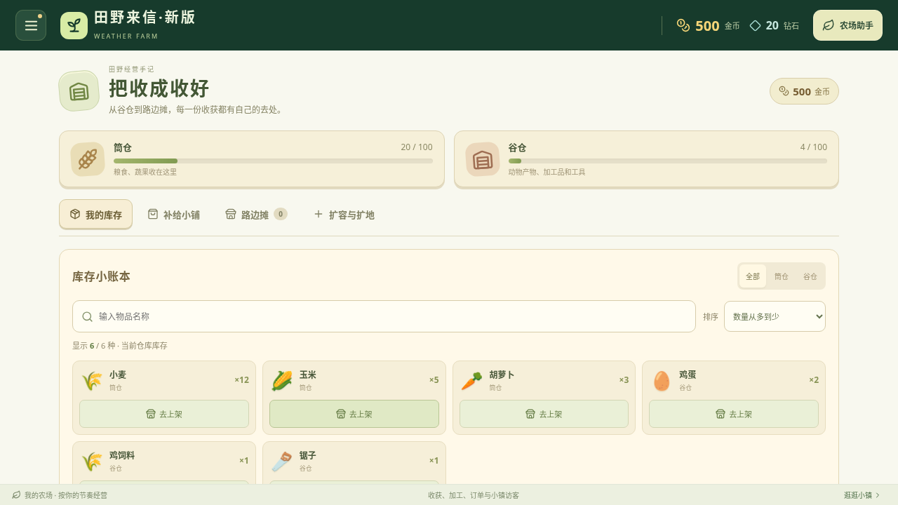

# v0.31.0 经营体验整合优化

本轮将新手经营、仓库操作、时钟计算及更新提示合并到一个版本。

## 第一次进入农场

农田与牧场底部显示“第一轮经营”，依据真实收获次数、养殖产物收取次数、交付订单数推进。卡片只定位可操作目标，不代替收获、购买或交货，也不追加奖励。成熟判断使用真实readyAt；满仓先整理库存，缺种与缺饲料给出相应来源，未解锁船单不会成为目标。完成三项的存档不再显示新手卡。

卡片可收起；详情面板、操作工具、补货返回、提示消息与弹窗出现时隐藏，避免争抢触摸空间。

## 仓库查找与上架

持有物品可按名称搜索、仓库类别过滤和数量降序排列，数量相同时保持原物品顺序。空结果可清除搜索。库存卡片的“去上架”会打开路边摊并预选准确商品、数量1及标准价，保留当前库存与留种提醒；最后手动“摆上摊位”才消耗商品。

## 时钟刷新

新增refreshGameClock仅更新有变化的田地／畜栏记录，未变化时复用引用，避免每秒深拷贝库存、订单、队列、小镇和布局。原tickGame继续为经济操作提供独立副本，不能将经济动作中的tickGame直接替换成共享引用刷新。

[可复现基准](game-clock-benchmark-v0.31.json)由scripts/benchmark-game-clock.ts生成。当前云端Node环境中，每组2000次刷新、5轮中位数：新农场109.19→13.89ms，成熟空闲农场101.21→14.20ms，中后期农场151.55→57.12ms，对应CPU耗时减少约62%–87%。它只测时钟计算，不包含绘制、网络或安卓设备性能，不能据此声称真机帧率、内存或功耗改善。

## 游戏内更新

v0.29及之后的“田野来信·新版”使用同一固定签名，可通过左上角菜单→检查更新→下载→安装更新覆盖更新，保留本应用资料。仅从旧包名首次迁入时需要分别导出／导入。

## 验证范围

379项TypeScript规则、类型检查及生产构建通过，包含11项新手目标、8项轻量时钟及5项库存查询规则。新增34组新手／仓库浏览器检查通过，原有订单返回24组、小镇补货22组、按需加载27组、物品来源33组、小镇看板14组回归通过，合计154组，页面错误和本地资源请求失败为0。默认动画下额外连续三轮真实经营操作通过15项复查。

公开安装包核验结果在发布后补录。截图使用隔离测试农场，不是玩家资料或真机照片。
