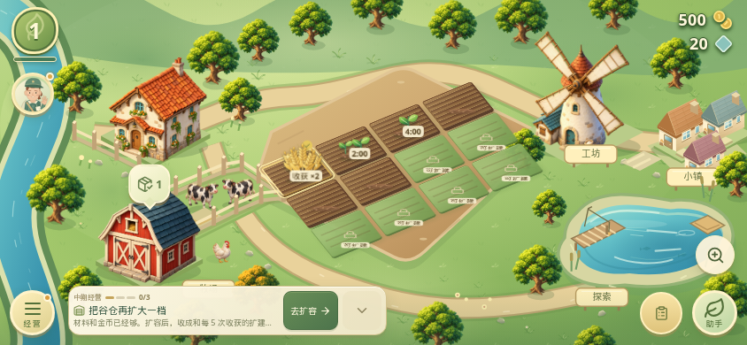

# v0.32.0 中期经营、触控与早期节奏

本轮在 v0.31 第一轮经营完成之后，补上可收起的中期引导，并把农田、牧场、经营面板的关键触控与早期扩仓、订单节奏收紧。不新开项目，不改包名，不改签名。

## 中期经营

第一轮三项（收获、养殖收取、订单交付）都完成后，农田和牧场底部显示“中期经营”。三步都从现有存档推导，不新增字段，也不发奖励：

- 扩仓或开新田：筒仓、谷仓超过开局 100，或已解锁田块超过 6。
- 工坊连产：同一工坊队列里有两份制作，或已有第三座工坊，或某个工坊槽位超过 2。
- 稳定交付：卡车或货船累计交付达到 4。未解锁的船单不会成为目标，定位仍用订单 ID 和配送类型。

卡片只打开对应页面。扩容、播种、排队和交货仍要玩家自己确认。三步完成后不再显示。详情、工具、补货返回、提示、弹窗和菜单打开时隐藏。队列里的两份制作收完后，如果还没有新工坊或额外槽位，连产这一步会再次出现；这是为了不写新的存档标记。



截图来自隔离测试存档：只把收获、养殖收取和订单交付设为 1，其余用开局农场。不是玩家资料，也不是真机照片。

## 触控与读屏

横屏下，地块面板和畜舍面板的关闭、主操作、仓库或饲料入口，以及经营面板的页签、筛选、上架、扩容和订单按钮，触控高度对齐到 44px。这些按钮保留可见焦点环。收获、播种、收集和购买按钮用说明文字补充读屏，不改它们原来的按钮名称。成功的经济操作继续走原有 `commitGame`：安卓上使用已依赖的 `@capacitor/haptics` 轻触，网页上补一次很短的振动；提示和地块反馈在减少动态效果时仍保持可见，按下不再位移。地块几何和点击穿透没有改。

## 产能与仓库

金币档位没改。100、125、150 这三档扩仓材料都是每种 1 份；175 起材料数量回到原来的档位。开局每种扩建材料有 2 份，因此前两次扩仓不再被“第二种材料要等约 65 次收获”卡住。第二次扩仓的金币仍是 400，材料够而金币不够时不会扣材料。

9 级之前，订单每一行不超过一次收获（作物 2）、一次果园采摘（水果 3）、一次配方产出或一次养殖收取。9 级及以上仍用原来的数量曲线，42 级卡车仍可要 8 份。1 到 5 级的卡车订单原本就落在这个上限里。船单从 5 级解锁起，不再在刚解锁时按“基础数量再加 2”去要一整行。

谷仓已满时，中期引导先去整理库存，并说明这一轮收获的扩建材料会错过。满仓时收获奖励被跳过的原规则没有改。

## 验证

在本环境执行：

```bash
npm ci
npm test
npm run build
python -m unittest discover -s tests -p 'test_next*.py'
```

结果：TypeScript 规则 390 项通过（含 9 项中期引导、2 项早期订单与扩仓材料）。`tsc -b` 与 Vite 生产构建通过，生产、小镇、经营面板仍是按需加载的独立 chunk。Python 策略测试 8 项通过。150 档材料改为每种 1 份是在浏览器检查之后收紧的，页面流程没有变，这个数字由单元测试锁定；上面的 `npm test` 与 `npm run build` 跑的是收紧之后的源码。

浏览器使用系统 Chrome 与本机 Playwright，对 `http://127.0.0.1:4180` 的生产预览执行：`check-quality-pass.py` 42 组、`check-order-supply-return.py` 24 组、`check-town-supply-return.py` 22 组、`check-lazy-pages.py` 27 组、`check-item-sources.py` 33 组、`check-town-activity.py` 14 组。合计 162 组，页面错误和本地资源失败为 0。覆盖 640×360、844×390、1280×720，以及减少动态效果和保留动画两种设置。回归脚本重绘过的旧截图已还原，本轮只保留上面的隔离测试截图。

这些检查跑在云端浏览器和 Node 里，不能当成真机帧率、内存、功耗或安装器覆盖安装的结果。

## 发布状态

本轮只交付可合并的源码。公开安装包仍是 v0.31.0（versionCode 32）。v0.32.0 的 versionName 与 versionCode 33 已写入源码，尚未跑 Android 构建和签名发布。
