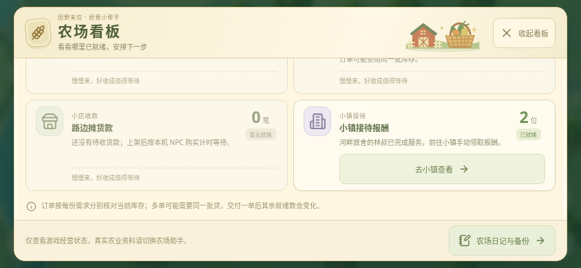

# 农场看板 · 小镇接待提醒

基于已发布的 v0.28.0 开发，尚未发布为新 APK。

农场看板增加“小镇接待报酬”，按已经完成服务、尚未领取报酬的访客人数显示。点“去小镇查看”会选择对应店铺，滚动至具体访客并把键盘焦点放在访客卡片上；玩家仍需主动点“领取报酬”。正在服务的访客参加“下一份期待”的最近完成时间比较，倒计时结束后进入待领奖人数。

查看与导航不扣库存、不领取报酬、不接待访客或召唤列车。待接待访客和列车冷却不计作服务完成。多个设施同时完成时按存档里的访客顺序定位；相同完成时间下，保留原有农场事项的优先顺序。页面计时刷新保留玩家后来手动选择的店铺。导航目标若已离开，停留在对应店铺；不会代替玩家执行其他操作。

保留原经济数值、Game version 2、存档格式、游戏备份和独立农场助手。本轮没有改动安卓签名或版本号。

## 验证

- `npm test`：337 项通过，包含新增 6 项小镇看板规则测试。覆盖实际服务和领取前后计数、精确完成时刻、多个设施与其他生产倒计时比较、同刻顺序、异常或未建成设施数据、冻结输入只读性。
- `npm run build`：TypeScript 检查与 Vite 生产构建通过；保留现有主包体积提示。
- 最终生产网页的 14 组 Chromium 检查通过，页面运行错误为 0。640×360、844×390、1280×720 各检查六项看板、人数与最近计时、无横向溢出、键盘进入指定旅舍访客、手动选店不被刷新覆盖、实际领取后精确报酬及人数变化、再次进入咖啡馆访客、倒计时完成后新增人数且不发报酬。另检查正常页面转场和无小镇字段的旧存档。
- 上述流程比较库存、金币、钻石、经验、小镇、工坊与布置快照；纯查看和导航保持不变。四个独立真实资料键的原文保持不变。

浏览器检查可复跑：先执行 `npm run build`，另开终端运行 `npm run preview`，再执行 `python scripts/check-town-activity.py`。需要单独安装 Python Playwright 和 Chromium；可通过 `CHROMIUM_PATH` 指定浏览器路径，URL 可作为脚本首个参数。脚本使用隔离浏览器存储和明确的测试时钟，阻断外部 HTTPS。

## 实际界面

下列 844×390 截图来自最终生产网页，关闭动态效果。使用明确构造并通过存档校验的隔离测试存档：三个已建成的一级小镇设施、六位访客，其中两位已完成、两位正在服务、两位等候。第二张在手动领取旅舍报酬后从看板进入咖啡馆访客。它们不代表新农场自然经营进度，也不是安卓真机画面。

看板滚动至小镇提醒：

看板入口定位至咖啡馆访客卡片：

未进行安卓真机帧率、内存、功耗或系统覆盖安装测试；本轮没有生成或发布 APK。
