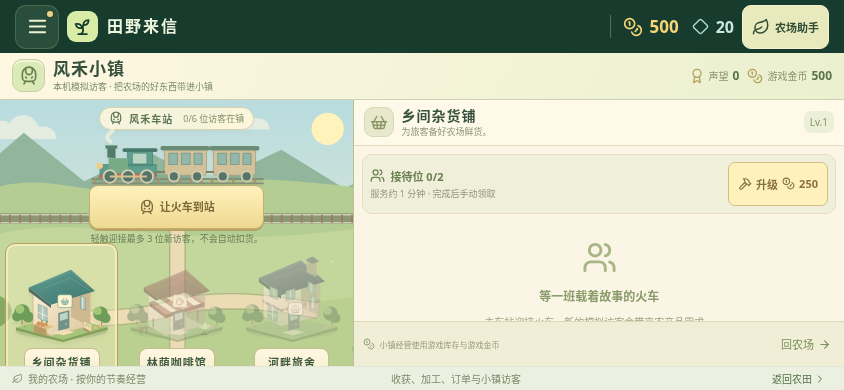

# v0.25.0 小镇画面升级

乡间杂货铺、林荫咖啡馆、河畔旅舍和列车换上为本项目生成的原创插画，分别保留青绿、陶红、淡紫的建筑辨识色。新增瓦片、木结构、窗台花箱、货篮与车厢材质；小镇背景采用柔和山丘、草地纹理、石子路和复用的主地图树木。

四张透明 WebP 合计 545,468 字节，均随安装包提供；没有复制第三方游戏素材。建筑和列车为静态插画，本轮没有加入列车行驶或轮子动画。图片失败时独立回退原矢量，树木也有矢量后备。

## 新农场前后对比

下列 844×390 浏览器截图分别来自已校验的公开 v0.24.0 APK 网页资源和最终 v0.25.0 构建；两者都是新农场，进入小镇前未注入等级、声望、金币或库存。咖啡馆与旅舍仍按原规则显示为未建造。均关闭动态效果，非安卓真机实录。

升级前：

升级后：

## 全部建筑展示：测试存档

下图使用明确注入的隔离测试存档：声望 8、游戏金币 3000、三座建筑均 1 级，再手动迎接一班列车。用于展示三座已建建筑的完整颜色，**不代表新农场已获得这些进度**。1280×720 浏览器截图，非真机实录。

建筑按钮、列车位置、外框尺寸和触控范围与公开 v0.24.0 相同。解锁、建造、接待扣货、服务计时、手动领奖和存档结构沿用原规则；美术不产生访客或报酬。真实天气、定位与本地AI等服务继续在独立农场助手中。

资源尺寸、来源 PNG 和交付文件的 SHA-256 见 [资源清单](art-assets-v0.25.json)；检查范围见 [验证记录](validation-v0.25.md)。
