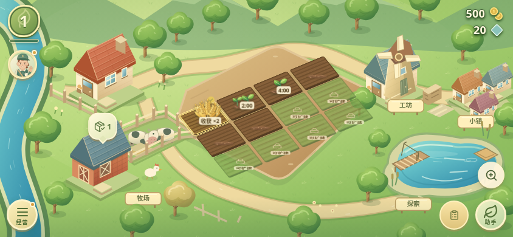
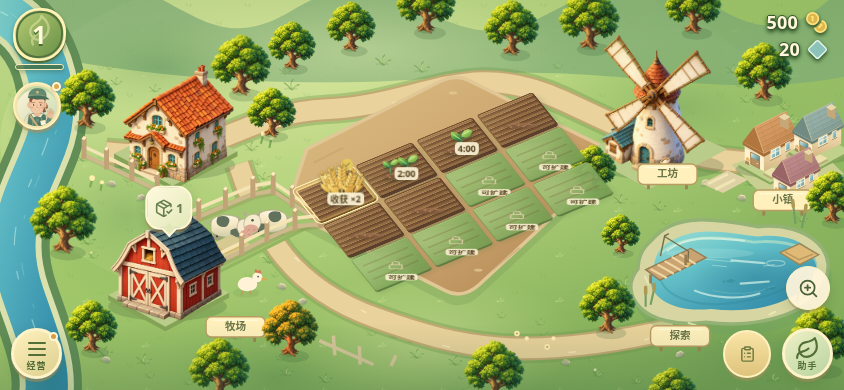

# v0.23.0 农场画面升级

游戏场景采用新生成的原创树木、农舍、畜舍与风车插画，统一左上方暖光、屋檐阴影和自然材质。图片以透明 WebP 随安装包离线提供；图片加载失败时回退原有 SVG 图形。新风车插画的帆叶是静态美术，不代表工坊生产状态。

草地增加不同密度的草丛、零星小花和石子，远景改为柔和丘陵；道路、田垄增加明暗层次，水塘增加水深和水下鱼影。鱼影仅作装饰，不表示游戏鱼类数量、钓鱼奖励或真实养殖情况。

画面与布局沿用 1200×700 世界坐标、地块和地标点击区域及现有存档结构。没有新增常驻界面入口。真实天气、定位与农场资料继续在独立农场助手中。

## 实际画面对比

以下是 844×390 浏览器横屏实录，使用相同固定起始时钟的新农场；没有注入等级或库存，开启系统减少动态效果。不是概念图或安卓真机照片。

| v0.22.0 | v0.23.0 |
| --- | --- |
|  |  |

四张插画共约 1.18 MB，原始分辨率 1254×1254，压缩时保留透明度和分辨率；具体字节数、SHA256 与生成来源见 [素材清单](art-assets-v0.23.json)。原始生成 PNG 保留于工作区，仓库提交运行所需 WebP。没有使用其他游戏的图片素材。

未完成安卓真机帧率、内存占用和功耗测试，不把浏览器检查视为真机性能结论。
