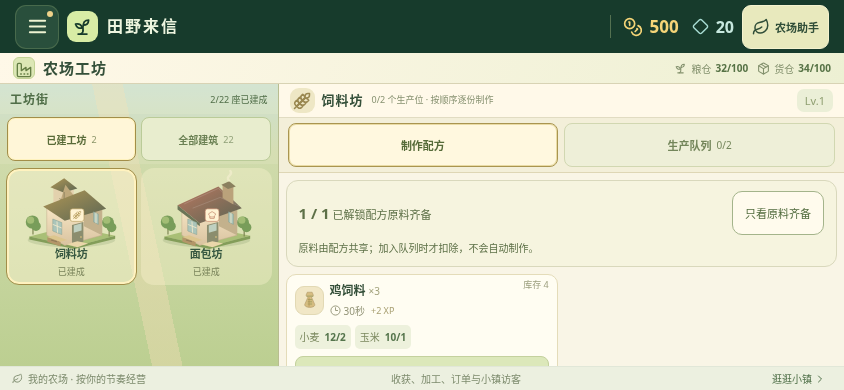
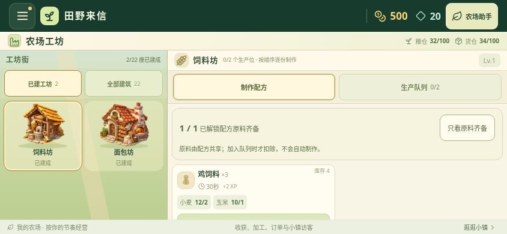
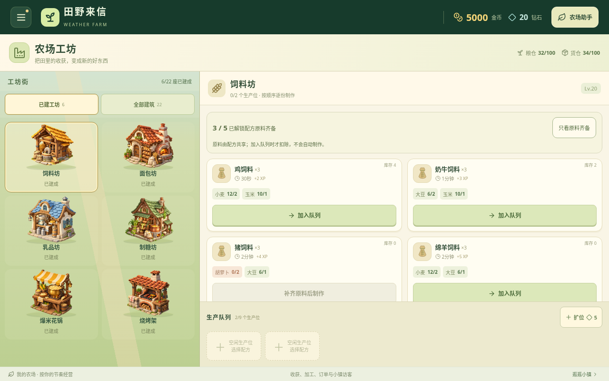

# v0.26.0 前期工坊美术升级

饲料坊、面包坊、乳品坊、制糖坊、爆米花锅和烧烤架换上为本项目生成的原创插画。六种设施分别突出磨盘与粮斗、面包炉、奶罐与分离器、甘蔗压榨机与铜锅、爆米花锅、砖砌烤炉，便于辨认用途。小型地面与接地阴影让设施更融入工坊街。

六张透明 WebP 合计 993,454 字节，均随安装包提供；没有复制第三方游戏素材。插画为静态，炉火、蒸汽和设备外观不表示生产状态，是否制作或可收取仍以原有文字和实际队列时间为准。本轮没有新增磨盘转动、蒸汽或烹饪动画；其他 16 类生产建筑继续使用原矢量。新插画加载失败时也独立回退原矢量。

## 新农场前后对比

下列 844×390 浏览器截图分别来自已校验公开 v0.25.0 APK 的网页资源和最终 v0.26.0 构建。两者都是新农场，未注入等级、金币、建筑或库存；原本已建的饲料坊和面包坊可见。均关闭动态效果，非安卓真机实录。

升级前：

升级后：

## 六种设施展示：测试存档

下图使用明确注入的隔离测试存档：等级 20、游戏金币 5000、六种设施已建成，每座两个空生产位。用于展示本轮六张插画，**不代表新农场已获得这些进度**。1280×800 浏览器截图，非真机实录。

三个横屏尺寸中，全部 22 类建筑卡片和美术外框均与公开 v0.25.0 相同。新插画不改变解锁、建造、扣料、串行制作、收取、满仓限制或存档结构；真实天气、定位和本地AI等服务继续在独立农场助手中。

资源尺寸、来源 PNG 和交付文件的 SHA-256 见 [资源清单](art-assets-v0.26.json)；检查范围见 [验证记录](validation-v0.26.md)。
