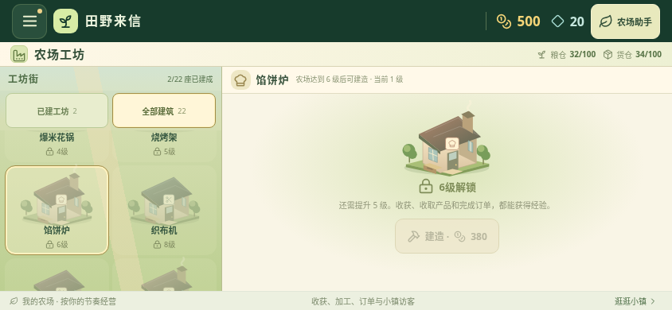
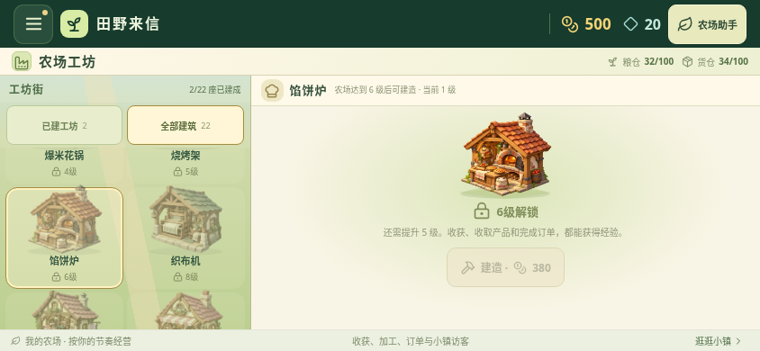
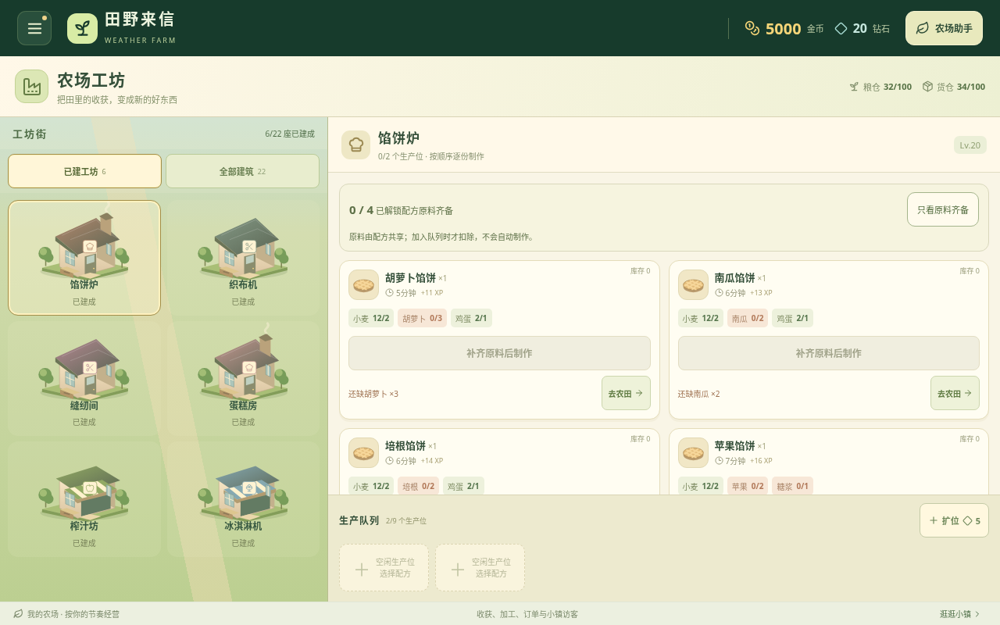
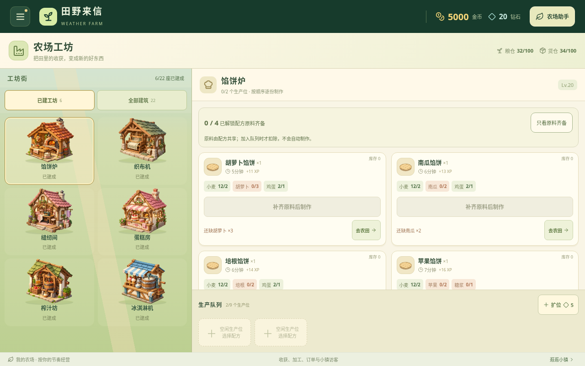

# v0.27.0 中期工坊美术升级

馅饼炉、织布机、缝纫间、蛋糕房、榨汁坊和冰淇淋机换上为本项目生成的原创插画。六种设施突出馅饼炉台、织布结构、缝纫机与布料、蛋糕烘焙台、木制压榨机、手摇冰淇淋桶等特征，让用途更容易辨认。

新增六张透明 WebP 合计 992,978 字节，均随安装包提供；没有复制第三方游戏素材。连同上一版，现有十二类工坊采用插画，其余十类继续使用原矢量。插画为静态，炉火、食物、布料与设备细节不表示当前生产或库存状态；以原有队列、文字与实际计时为准。本轮没有加入设备运转动画。图片失败时独立回退原矢量。

## 新农场查看待解锁设施

下列 844×390 浏览器截图分别来自已校验公开 v0.26.0 APK 的网页资源和最终 v0.27.0 构建。两者都是正常新农场，仅打开“全部建筑”查看馅饼炉，未注入等级、金币、建筑或库存。馅饼炉仍为 6 级解锁，不能在 1 级建造。关闭动态效果，非安卓真机实录。

升级前：

升级后：

## 六种已建设施前后对比：相同测试存档

以下两图使用相同、明确注入的隔离测试存档：等级 20、游戏金币 5000，仅列出这六种中期设施，每座两个空生产位。用于比较本轮六张插画，**不代表新农场已获得这些进度或正常升级过程**。1280×800 浏览器截图，非真机实录。

升级前：

升级后：

三个横屏尺寸中，全部 22 类建筑卡片和美术外框与公开 v0.26.0 相同。新插画不改变解锁、建造、扣料、串行制作、手动收取、满仓限制或存档结构；真实天气、定位和本地AI等服务继续在独立农场助手中。

资源尺寸、来源 PNG 和交付文件的 SHA-256 见 [资源清单](art-assets-v0.27.json)；检查范围见 [验证记录](validation-v0.27.md)。
