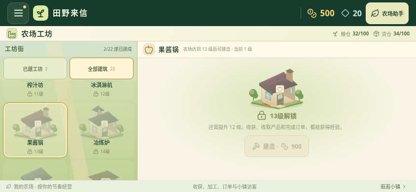
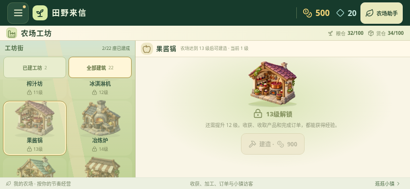
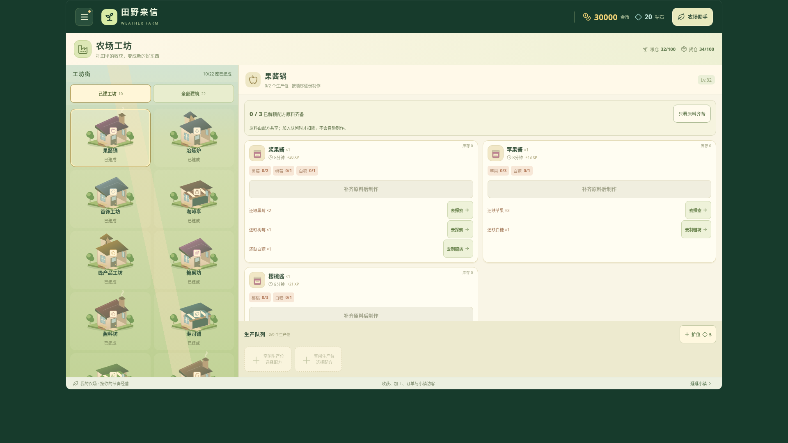
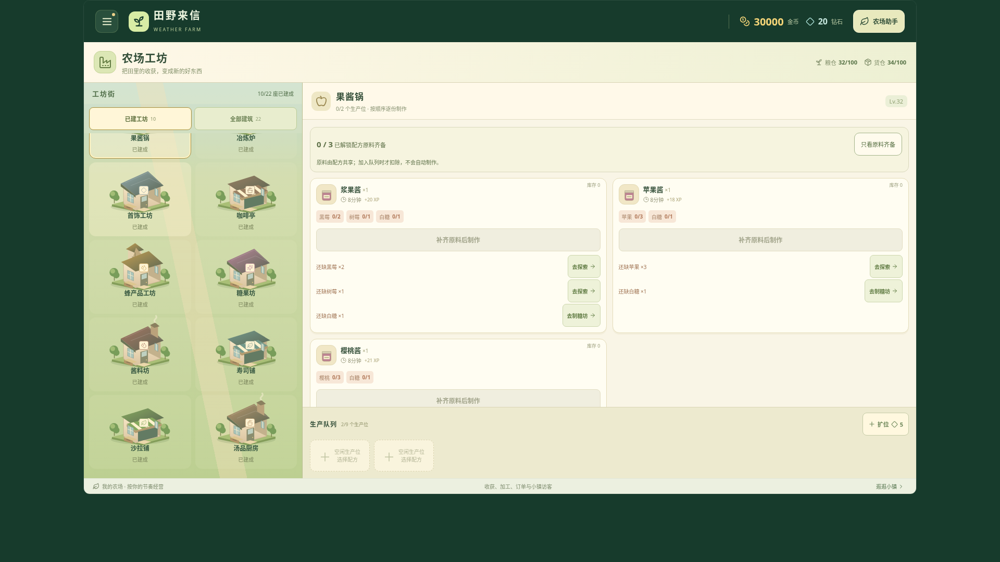
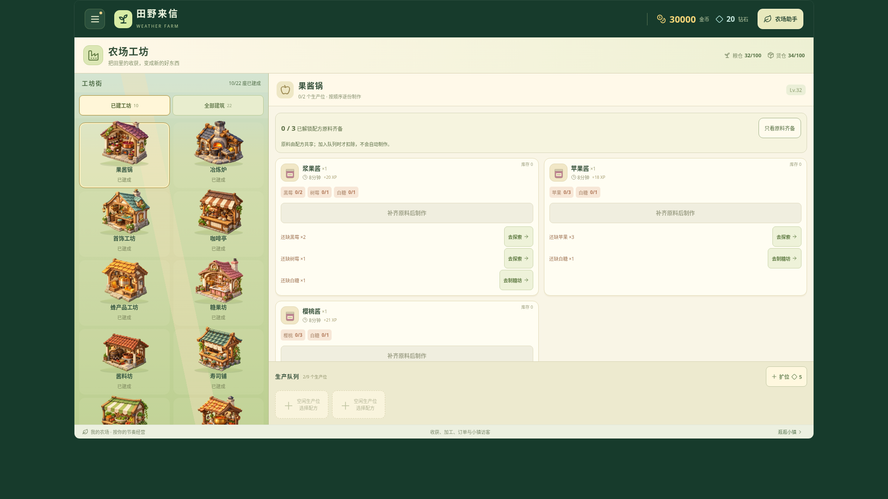
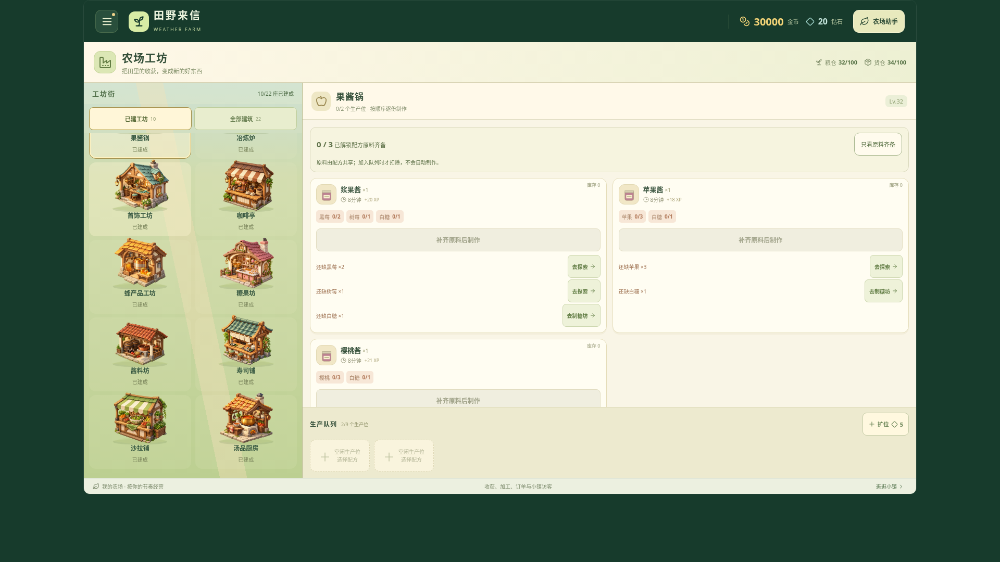

# v0.28.0 全部 22 类工坊统一美术

本轮补齐果酱锅、冶炼炉、首饰工坊、咖啡亭、蜂产品工坊、糖果坊、酱料坊、寿司铺、沙拉铺和汤品厨房。铜锅、坩埚、首饰工作台、咖啡机、蜂蜜分离桶、发酵桶与餐食台各有辨识特征，现有全部 22 类工坊建筑卡片采用统一的原创插画。

新增十张透明 WebP 合计 1,569,650 字节，随安装包提供；没有复制第三方游戏素材。插画为静态，炉火、餐食和器材细节不代表当前队列或库存。原矢量继续作为每座设施图片失败时的独立后备。本轮没有加入设备运转动画或单独建筑地图摆放。

## 新农场查看待解锁设施

下列 844×390 浏览器截图分别来自已校验公开 v0.27.0 APK 的网页资源和最终 v0.28.0 构建。两者都是正常新农场，只打开“全部建筑”查看果酱锅，未注入等级、金币、建筑或库存。果酱锅仍为 13 级解锁，1 级不能建造。关闭动态效果，非安卓真机实录。

升级前：

升级后：

## 十种已建设施对比：相同测试存档

以下截图使用相同、明确注入的隔离测试存档：等级 32、游戏金币 30000，仅列出这十种后期设施，每座两个空生产位。用于比较十张插画，**不代表新农场已获得这些进度或正常升级过程**。1920×1080 浏览器截图，分别显示列表上段与滚动后的下段，非真机实录。

升级前，上段与下段：

升级后，上段与下段：

三个横屏尺寸中，全部 22 类建筑卡片和美术外框与公开 v0.27.0 相同。解锁、建造、扣料、串行制作、手动收取、满仓限制与存档规则保留；真实天气、定位和本地AI等服务继续在独立农场助手中。

资源尺寸、来源 PNG 和交付文件的 SHA-256 见 [资源清单](art-assets-v0.28.json)；检查范围见 [验证记录](validation-v0.28.md)。
